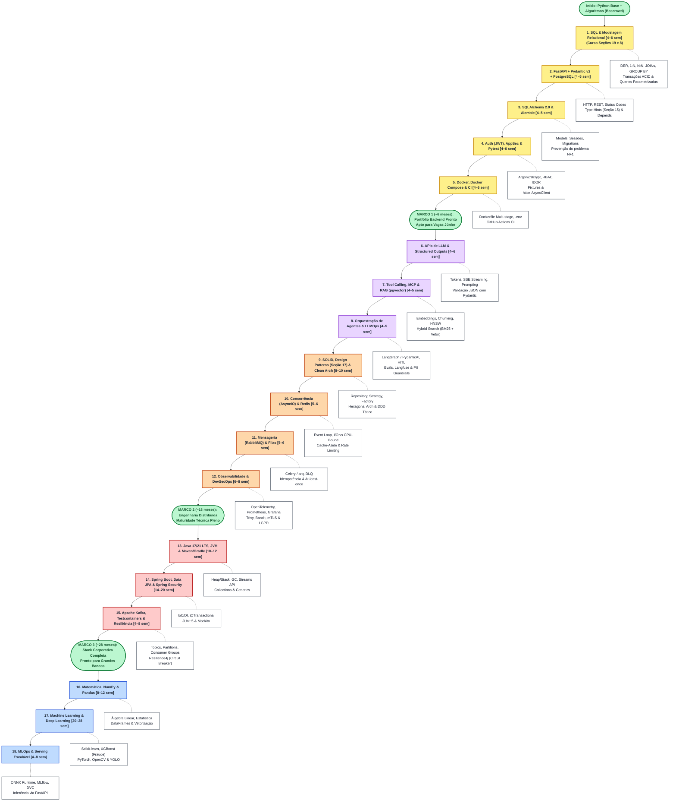

# Roadmap Master: Engenharia Backend, Arquitetura, Java & Inteligência Artificial

> **Objetivo:** Construir uma formação completa e progressiva em engenharia de software, saindo dos fundamentos de Python e SQL até sistemas distribuídos de alta escala, Java empresarial (foco em bancos/fintechs), Cibersegurança aplicada e Inteligência Artificial (Agentes, RAG e Machine Learning).

## Cronograma Executivo (Base: 30 a 60 min/dia + Prática)

> **Nota Importante:** As estimativas abaixo consideram o seu ritmo atual (30 a 60 minutos diários além da faculdade e estágio). **Você não precisa esperar o fim do roadmap para entrar no mercado** — o gatilho de candidatura para vagas Júnior acontece logo após a Fase 1.

| Fase | Foco Principal | Duração Estimada | Tempo Acumulado | Marco de Carreira / Entrega |
| :--- | :--- | :--- | :--- | :--- |
| **Fase 1** | SQL, FastAPI, ORM, Auth, Testes & Docker | **5 a 7 meses** | ~6 meses | **Pronto para Vagas Júnior Backend** |
| **Fase 2** | Engenharia de IA Aplicada (LLMs, RAG & Agentes) | **3 a 4 meses** | ~9 a 11 meses | Diferencial competitivo em IA aplicada |
| **Fase 3** | Arquitetura, Concorrência, Redis, Filas & Observabilidade | **6 a 8 meses** | ~15 a 19 meses | **Maturidade Técnica Nível Pleno** |
| **Fase 4** | Java 17/21 LTS, Spring Boot, Security & Kafka | **7 a 10 meses** | ~22 a 29 meses | **Stack Corporativa para Grandes Bancos** |
| **Fase 5** | Ciência de Dados, Machine Learning & MLOps | **8 a 12 meses** | ~30 a 41 meses | Especialização em Modelos Preditivos & Visão |

---

## Fase 1: Fundação Backend, Persistência & Segurança Básica `[5 a 7 meses | Meta: Vaga Júnior]`

O objetivo desta fase é dominar o fluxo completo de uma aplicação web moderna: receber requisições HTTP, validar contratos, aplicar regras de negócio seguras, persistir em banco relacional e empacotar tudo com testes automatizados.

### 1.1 Bancos de Dados Relacionais & SQL Puro *(~4 a 6 semanas)*

* **No Curso:** **Seção 19 inteira** (Modelagem, DER, SQL) e **Seção 8** (Drivers Python e SQL Injection).
* [ ] **Modelagem de Dados:** `Entity-Relationship Diagram (ERD)`, chaves primárias/estrangeiras, cardinalidade (`1:1`, `1:N`, `N:N` com tabelas associativas), normalização (`1FN`, `2FN`, `3FN`).
* [ ] **SQL Avançado:** `INNER JOIN`, `LEFT JOIN`, `RIGHT JOIN`, `GROUP BY`, `HAVING`, funções de agregação (`COUNT`, `SUM`, `AVG`), subqueries e `CTE (Common Table Expressions)`.
* [ ] **Integridade e Transações:** `ACID properties`, `BEGIN / COMMIT / ROLLBACK`, constraints (`ON DELETE CASCADE / RESTRICT`), índices básicos (`B-Tree`).
* [ ] **Drivers & Segurança:** Python DB-API (`PyMySQL`, `psycopg3`), cursores e prevenção de SQL Injection via *parameterized queries*.

### 1.2 APIs REST, FastAPI & ORM Moderno *(~8 a 10 semanas)*

* **No Curso:** **Seção 15** (*Type Annotations* — base para Pydantic).
* **Por Fora:** Documentação oficial do FastAPI, SQLAlchemy e Alembic.
* [ ] **Fundamentos Web & HTTP:** Métodos (`GET`, `POST`, `PUT`, `PATCH`, `DELETE`), Status Codes (`2xx`, `4xx`, `5xx`), Headers, `CORS`, arquitetura *Stateless* e JSON.
* [ ] **FastAPI & Contratos:** Roteamento, `Dependency Injection (Depends)`, validação e serialização estrita com **Pydantic v2**, documentação OpenAPI/Swagger.
* [ ] **Persistência & Migrações:** **SQLAlchemy 2.0** (mapeamento declarativo, sessões, relacionamentos, prevenção do problema `N+1`) e **Alembic** (versionamento de schema e migrations).

### 1.3 Autenticação, AppSec Básico & Qualidade *(~8 a 12 semanas — inclui projeto de portfólio)*

* **No Curso:** **Seção 14** (mentalidade de TDD e testes unitários).
* [ ] **Autenticação & Autorização:** Hashing seguro de senhas (`Argon2` / `bcrypt`), **JWT (JSON Web Tokens)** (*Access* e *Refresh Tokens*), `OAuth2 Password Flow` e `RBAC (Role-Based Access Control)`.
* [ ] **Segurança Defensiva (OWASP Top 10):** Proteção contra `Broken Access Control (IDOR)` (garantir isolamento de dados por usuário), gestão de segredos com `.env` e princípio do menor privilégio no banco.
* [ ] **Testes Automatizados:** **`pytest`**, `fixtures`, mocks e testes de integração de endpoints com `httpx.AsyncClient`.
* [ ] **Containerização & Git:** `Dockerfile` multi-stage, **`Docker Compose`** (orquestrando API + PostgreSQL), fluxo Git profissional (`Conventional Commits`, Pull Requests) e CI básico no **GitHub Actions**.

---

## Fase 2: Engenharia de IA Aplicada (LLMs, RAG e Agentes) `[3 a 4 meses | Pós-Fase 1]`

* **Por que aqui?** Porque integrar LLMs em produção depende 80% do que você acabou de construir na Fase 1 (FastAPI, Pydantic, PostgreSQL e requisições assíncronas).

### 2.1 APIs de LLM, Prompts & Contratos Estritos *(~4 a 6 semanas)*

* [ ] **Mecânica & SDKs:** SDKs oficiais (OpenAI, Google GenAI, Anthropic), `Context Window`, `Tokenization`, custos (`Input vs Output`), `Temperature`, `TTFT` e `Server-Sent Events (SSE) Streaming`.
* [ ] **Structured Outputs:** Forçar respostas tipadas e validadas com **Pydantic / JSON Schema**.
* [ ] **Engenharia de Prompt Sistemática:** `System vs Developer vs User Prompts`, `Few-Shot Prompting`, `Chain-of-Thought (CoT)`, delimitadores XML e versionamento de prompts.

### 2.2 Tool Use, RAG & Orquestração de Agentes *(~8 a 10 semanas)*

* [ ] **Function Calling & MCP:** `Tool Use loop` (LLM acionando funções Python com validação determinística) e **Model Context Protocol (MCP)**.
* [ ] **RAG (Retrieval-Augmented Generation):** `Text Embeddings`, busca vetorial no PostgreSQL com **`pgvector`** (`HNSW`), estratégias de `Chunking`, `Hybrid Search (BM25 + Vetorial)` e `Reranking`.
* [ ] **Arquitetura de Agentes:** Padrões (*Routing*, *Prompt Chaining*, *Reflection*), máquinas de estado com **LangGraph** ou **PydanticAI**, persistência de memória (`Checkpointers`) e `Human-in-the-Loop (HITL)`.
* [ ] **LLMOps & Segurança de IA:** Testes com `LLM Evals` (`Golden Datasets`, `LLM-as-a-Judge`), tracing com **Langfuse / OpenTelemetry**, defesa contra `Prompt Injection` e mascaramento de dados sensíveis (`PII Redaction`).

---

## Fase 3: Engenharia de Software, Concorrência & Sistemas Distribuídos `[6 a 8 meses | Meta: Nível Pleno]`

Aqui você deixa de apenas construir CRUDs e aprende a projetar sistemas resilientes, escaláveis, desacoplados e observáveis.

### 3.1 Engenharia de Software & Arquitetura *(~8 a 10 semanas)*

* **No Curso:** **Seção 17** (*Design Patterns* — GoF).
* [ ] **Princípios & Padrões:** **SOLID**, *Design Patterns* criacionais, estruturais e comportamentais (`Repository`, `Service Layer`, `Factory`, `Strategy`, `Adapter`, `Dependency Injection`).
* [ ] **Arquitetura de Software:** *Clean Architecture*, *Hexagonal Architecture (Ports & Adapters)* e fundamentos de *Domain-Driven Design (DDD)* tático (Entidades, Value Objects, Aggregates).

### 3.2 Concorrência, Cache & Mensageria *(~10 a 12 semanas)*

* [ ] **Concorrência & Paralelismo:** Diferença real entre tarefas `I/O-Bound` e `CPU-Bound`, **`asyncio`**, *Event Loop*, corrotinas, `Multithreading` (GIL) vs `Multiprocessing`.
* [ ] **Cache & Estado em Memória:** **Redis** (estratégias `Cache-Aside`, invalidação, TTL, armazenamento de sessões e `Rate Limiting` distribuído).
* [ ] **Mensageria & Processamento Assíncrono:** Brokers (**RabbitMQ**), filas de tarefas em background (**Celery** ou **`arq`**), conceitos de `Dead Letter Queues (DLQ)`, `Idempotência` e garantia de entrega (*At-least-once*).

### 3.3 Observabilidade & DevSecOps Corporativo *(~6 a 8 semanas)*

* [ ] **Observabilidade (Os 3 Pilares):**
  * *Logs:* Structured Logging em JSON com `Correlation ID` (nunca logar senhas/tokens).
  * *Métricas:* **Prometheus** e dashboards no **Grafana** (latência p95/p99, taxa de erro, throughput).
  * *Tracing:* **OpenTelemetry** para rastrear requisições entre serviços.
* [ ] **Segurança Avançada (AppSec / DevSecOps):** Análise estática (`Bandit`), análise de vulnerabilidades em dependências (`pip-audit`), scan de imagens Docker (`Trivy`), criptografia em trânsito/repouso (`TLS`, `mTLS`, `AES-256`) e conformidade LGPD.

---

## Fase 4: Ecossistema Java Empresarial `[7 a 10 meses | Foco: Grandes Bancos & Fintechs]`

* **Por que aqui?** Toda a teoria de SQL, HTTP, transações, mensageria, testes e arquitetura já foi dominada. O foco agora é aprender a linguagem estática e o ecossistema padrão do setor financeiro.

* [ ] **Java Core & JVM *(~10 a 12 semanas)*:** Java 17 / 21 LTS, tipagem estática forte, `Collections Framework`, `Generics`, `Streams API`, `Lambdas`, gerenciamento de memória da **JVM** (`Heap`, `Stack`, `Garbage Collectors`) e build com **Maven** ou **Gradle**.
* [ ] **Spring Boot & Persistência *(~10 a 14 semanas)*:** `Spring Core (IoC / DI)`, `Spring Web`, **Spring Data JPA / Hibernate** (ciclo de vida das entidades, transações declarativas `@Transactional`, prevenção de `LazyInitializationException` e `N+1`).
* [ ] **Segurança & Testes no Java *(~4 a 6 semanas)*:** **Spring Security** (cadeia de filtros, OAuth2, JWT), **JUnit 5**, **Mockito** e **Testcontainers** (subindo PostgreSQL/Kafka reais em Docker durante os testes).
* [ ] **Mensageria de Alta Escala & Resiliência *(~4 a 8 semanas)*:** **Apache Kafka** (`Topics`, `Partitions`, `Consumer Groups`, `Offsets`) com Spring Kafka e padrões de resiliência com **Resilience4j** (`Circuit Breaker`, `Retry`, `Bulkhead`).

---

## Fase 5: Ciência de Dados, Machine Learning & MLOps `[8 a 12 meses | Longo Prazo]`

* **Foco:** Construir, treinar e disponibilizar modelos preditivos próprios (ex.: detecção de fraude bancária, credit scoring) e modelos de visão computacional.

| Etapa | Duração Estimada | Conceitos & Termos para Pesquisa | Ferramentas / Bibliotecas | Status |
| :--- | :--- | :--- | :--- | :--- |
| **1. Matemática & Dados** | ~8 a 12 semanas | `Linear Algebra`, `Calculus (Gradients)`, `Probability & Statistics`, `Vectorization` | `NumPy`, `Pandas` | `[ ]` |
| **2. ML Clássico (Tabular)** | ~10 a 14 semanas | `Supervised/Unsupervised Learning`, `Feature Engineering`, `Cross-Validation`, `ROC-AUC`, `Precision/Recall` | `Scikit-learn`, `XGBoost`, `LightGBM` | `[ ]` |
| **3. Deep Learning & Visão** | ~10 a 14 semanas | `Neural Networks`, `Backpropagation`, `CNNs`, `Transfer Learning`, `Object Detection` | `PyTorch`, `OpenCV`, `YOLO` | `[ ]` |
| **4. MLOps & Serving** | ~4 a 8 semanas | `Model Serialization (ONNX)`, `Feature Stores`, `Data Drift`, `Experiment Tracking` | `FastAPI`, `ONNX Runtime`, `MLflow`, `DVC` | `[ ]` |

---

## Biblioteca Recomendada (Por Etapa)

### Leitura Imediata (Mentalidade, Algoritmos e Código Limpo)

1. **O Programador Pragmático** (*Andrew Hunt & David Thomas*) — *Mentalidade profissional, responsabilidade e como não programar por coincidência usando IA.*
2. **Entendendo Algoritmos** (*Aditya Bhargava*) — *Apoio visual direto para a prática diária no Beecrowd (Big-O, grafos, tabelas hash, PD).*
3. **A Philosophy of Software Design** (*John Ousterhout*) — *Combate à complexidade e identificação de abstrações rasas geradas por LLMs.*
4. **Código Limpo (Clean Code)** (*Robert C. Martin*) — *Legibilidade, nomeação e organização de funções (prepara também para a sintaxe Java).*
5. **Python Fluente** (*Luciano Ramalho*) — *Livro de consulta para Python idiomático, iteradores, decoradores e concorrência.*

### Médio e Longo Prazo (Dados, Arquitetura e IA)

6. **AI Engineering: Building Applications with Foundation Models** (*Chip Huyen*) — *Engenharia de produção sobre LLMs: prompts, RAG, agentes, Evals e otimização.*
7. **Designing Data-Intensive Applications** (*Martin Kleppmann*) — *A bíblia de backend: armazenamento, índices, transações, replicação, particionamento e mensageria.*

---

## Mapa Visual Completo (Estilo roadmap.sh)

> **Legenda de Cores:**
> * 🟨 **Amarelo:** Fase 1 (5–7 meses) — Fundação Backend, Persistência & AppSec Básico
> * 🟪 **Roxo:** Fase 2 (3–4 meses) — Engenharia de IA Aplicada (LLMs, RAG & Agentes)
> * 🟧 **Laranja:** Fase 3 (6–8 meses) — Arquitetura, Concorrência, Redis, Mensageria & Observabilidade
> * 🟥 **Vermelho:** Fase 4 (7–10 meses) — Ecossistema Java Empresarial & Spring (Bancos)
> * 🟦 **Azul:** Fase 5 (8–12 meses) — Machine Learning, Deep Learning & MLOps
> * 🟩 **Verde:** Marcos de Carreira e Projetos Práticos

